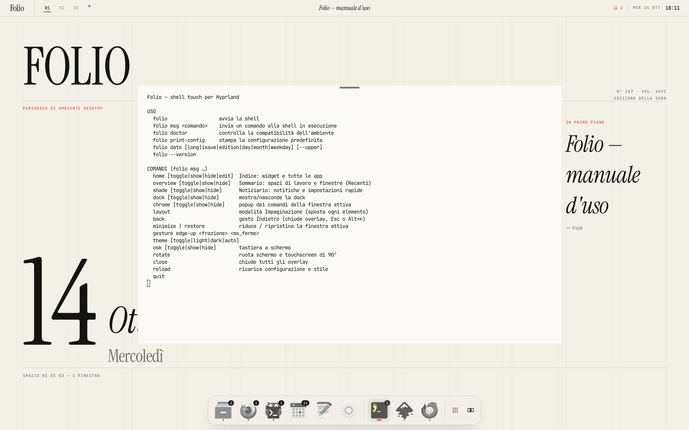
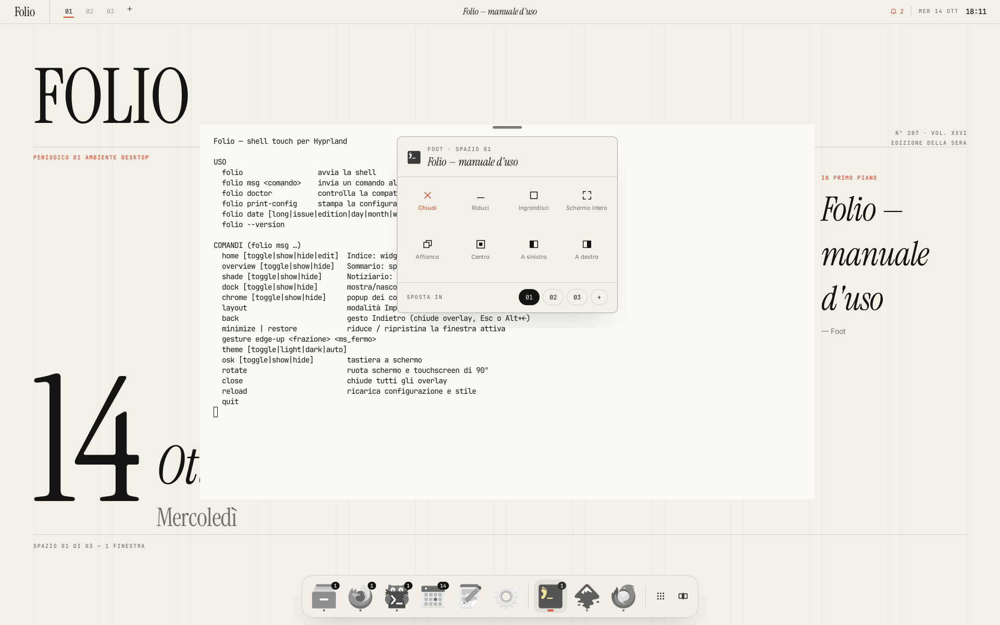
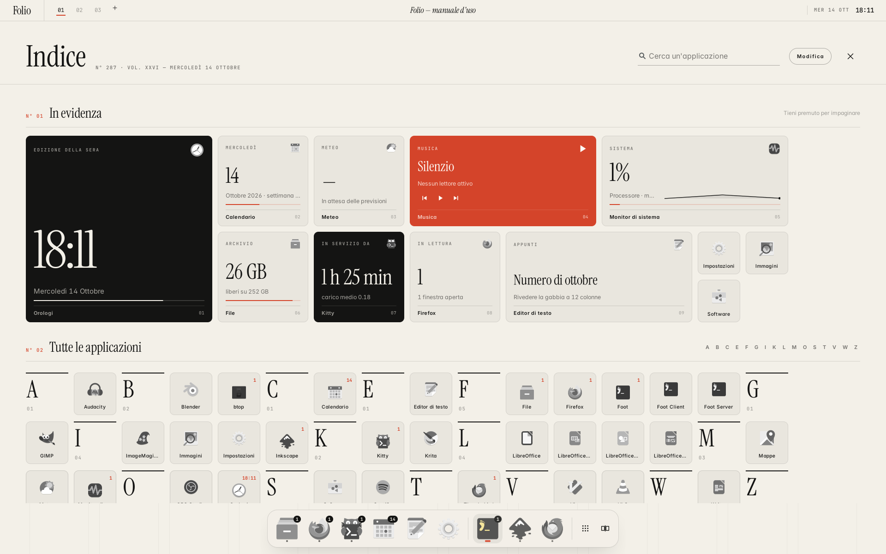
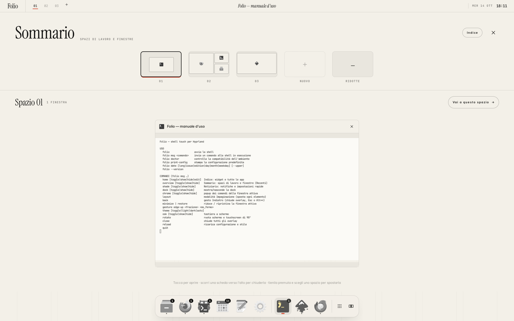
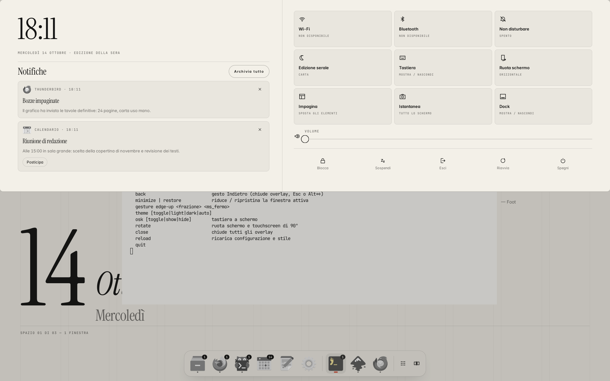
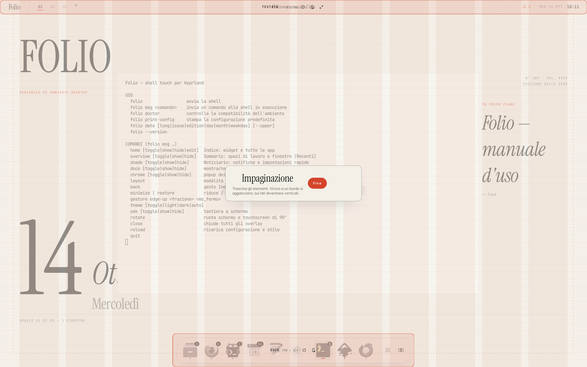
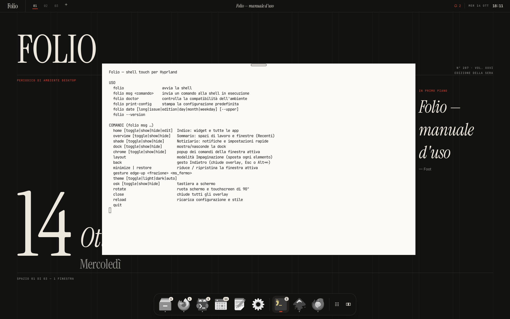

# FOLIO

**Periodico di ambiente desktop.** Una shell touch per **CachyOS + Hyprland**, scritta in **Rust** con **GTK4** (e temi coordinati per le app GTK3/GTK4), impaginata come una rivista di design: carta e inchiostro, un solo colore d'accento, filetti da un pixel, titoli in serif, cifre tabellari.


| | |
|---|---|
|  |  |
| *Ogni finestra ha una barra del titolo (o una pillola)…* | *…che con un popup rivela i comandi di gestione.* |
|  |  |
| *L'Indice: ogni icona è un widget vivo.* | *Tieni premuto: le tile oscillano come su iOS.* |
|  |  |
| *Il Sommario: spazi di lavoro alla GNOME Shell.* | *Il Notiziario, come su un tablet Android.* |
|  |  |
| *Impaginazione: trascina ogni elemento ovunque.* | *L'edizione serale (tema scuro automatico).* |

---

## Indice

1. [Requisiti e compatibilità](#requisiti-e-compatibilità)
2. [Installazione](#installazione)
3. [Gesti](#gesti)
4. [Le superfici](#le-superfici)
5. [Icone che si comportano da widget](#icone-che-si-comportano-da-widget)
6. [Configurazione](#configurazione)
7. [Comandi](#comandi)
8. [Struttura del progetto](#struttura-del-progetto)
9. [Come è stato verificato](#come-è-stato-verificato)
10. [Problemi noti e soluzioni](#problemi-noti-e-soluzioni)

---

## Requisiti e compatibilità

| Componente | Versione | Note |
|---|---|---|
| Distribuzione | CachyOS (o altra Arch con `pacman`) | x86_64; aarch64 non testato |
| Hyprland | **≥ 0.55** | configurazione in **Lua** (`hyprland.lua`). Folio stesso parla anche con Hyprland ≤ 0.54 (ripiega sulla sintassi classica dei dispatcher), ma i dotfile richiedono Lua |
| GTK | ≥ 4.12 | CachyOS: 4.20 |
| gtk4-layer-shell | ≥ 1.0 | CachyOS: 1.3.0 |
| Rust | ≥ 1.85 | l'installer usa il pacchetto `rust` o `rustup` |
| Plugin | `hyprbars`, `hyprgrass` | installati con `hyprpm`; senza hyprbars Folio usa da solo la pillola |
| Facoltativi | `wvkbd`, `iio-sensor-proxy` + `iio-hyprland` | tastiera a schermo, rotazione automatica |

`./installer.sh --check` esegue tutti i controlli senza modificare nulla:

- **sistema**: utente non root, distribuzione, architettura e livello x86-64, pacman e sudo, rete, spazio libero, memoria;
- **Hyprland**: versione installata e disponibile nei repository (≥ 0.55), sessione attiva, hyprlock, hypridle, polkit e portale, dipendenze di hyprpm, plugin già caricati;
- **grafica**: GPU (con le avvertenze per NVIDIA e `modeset`), GTK, gtk4-layer-shell, toolchain Rust;
- **tablet**: touchscreen (multitouch o a tocco singolo, con le penne escluse), interruttore 2-in-1, accelerometro, tastiera a schermo;
- **ambiente**: barre o demoni di notifica concorrenti (waybar, mako, swaync…), configurazioni esistenti, caratteri.

Dopo l'installazione, `folio doctor` ripete i controlli dall'interno della sessione: versione e IPC di Hyprland, plugin caricati, layer-shell, touchscreen, strumenti, caratteri e validità di `config.toml`.

## Installazione

```bash
git clone <questo repository> folio && cd folio
./installer.sh --check     # solo diagnosi
./installer.sh             # controlli → piano → conferma → installazione
```

L'installer:

1. installa i pacchetti con `pacman -Syu --needed`, cioè un aggiornamento completo come raccomanda Arch. Ciò che non è nei repository ufficiali passa da `paru`/`yay`; se non ci sono, `wvkbd` viene compilato dai sorgenti;
2. scarica **Instrument Serif** (licenza SIL OFL), mentre Inter, JetBrains Mono e IBM Plex arrivano dai repository;
3. compila Folio (`cargo build --release --locked`) e lo installa in `/usr/local/bin`;
4. **salva un backup** di ogni file che sostituisce in `~/.local/state/folio/backup-<data>/`, poi copia i dotfile. `config.toml`, `style.css` e `kitty.conf` esistenti non vengono mai toccati: il riferimento aggiornato finisce accanto, con estensione `.folio`. `~/.config/hypr/user.lua` è tuo e non viene mai sovrascritto;
5. installa e abilita **hyprbars** e **hyprgrass** con `hyprpm`;
6. ti propone di abilitare NetworkManager e Bluetooth.

Opzioni: `--yes`, `--force`, `--no-packages`, `--no-plugins`, `--no-dotfiles`, `--no-fonts`, `--link` (symlink, per chi sviluppa), `--user-bin` (binario in `~/.local/bin`, senza sudo), `--prefix DIR`, `--uninstall [--purge]`.

> Il passaggio di Hyprland da `hyprland.conf` a `hyprland.lua` avviene solo all'avvio: dopo l'installazione **esci e rientra**. La vecchia `hyprland.conf` resta al suo posto, ma con `hyprland.lua` presente Hyprland usa il Lua.

## Gesti

Pensati come su un tablet Android. Li misura hyprgrass, li interpreta Folio.

| Gesto | Azione |
|---|---|
| Dal bordo inferiore, **corto** | mostra la Dock (taskbar transitoria) |
| Dal bordo inferiore, **lungo** | **Indice** (Home) |
| Dal bordo inferiore, **lungo + pausa** | **Sommario** (Recenti e spazi di lavoro) |
| Lungo il bordo inferiore, in orizzontale | spazio precedente / successivo, seguendo il dito |
| Dal bordo sinistro o destro verso l'interno | **Indietro**: chiude l'overlay in cima, poi Esc sui dialoghi e Alt+← sulle finestre |
| Dal bordo superiore verso il basso | **Notiziario** (notifiche e impostazioni rapide) |
| Tre dita ← → | cambia spazio di lavoro |
| Tre dita ↑ / ↓ | Sommario / riduci la finestra |
| Tocco a tre dita | popup dei comandi della finestra attiva |
| Pizzico a tre dita (chiudi / apri) | Sommario / Indice |
| Pressione prolungata a 3 / 4 dita | sposta / ridimensiona la finestra |
| Pressione prolungata su bordi e spazi tra finestre | ridimensiona |
| Pressione prolungata su Testata o Dock | **Impaginazione** |

Dentro le superfici di Folio: swipe verso il basso chiude l'Indice; swipe verso l'alto chiude il Notiziario; swipe orizzontale sfoglia gli spazi nel Sommario; **swipe verso l'alto su una scheda chiude la finestra** (come nei Recenti di Android). Le soglie (8% / 220 ms / 55%) sono nella sezione `[gestures]` di `config.toml`.

## Le superfici

- **Copertina** (sfondo): testata, numero del giorno («N° 287 · Vol. XXVI»), data in corpo enorme, l'edizione del momento («Edizione della sera») e un articolo di copertina, cioè il titolo della finestra in primo piano oppure la citazione del giorno. In trasparenza, una gabbia a 12 colonne.
- **Testata** (barra di stato): sigla, spazi di lavoro numerati 01 02 03 +, titolo della finestra in corsivo (toccalo per i comandi), stato in forma tipografica e ora. Trascinarla verso il centro apre il Notiziario, come la tendina di Android. Diventa verticale sui bordi laterali.
- **Dock** (macOS/GNOME): app fissate e in esecuzione, un punto per finestra, micro-widget (il giorno sul calendario, la temperatura sul meteo, il numero di finestre…). Tenere premuta un'icona apre il menu: finestre aperte, nuova finestra, fissa/rimuovi, aggiungi all'Indice, metti sulla scrivania, chiudi tutte.
- **Barra del titolo con popup**: con **hyprbars** ogni finestra, dialoghi compresi, ha una testatina in serif con un solo pulsante «⋯». Senza il plugin (o con `chrome.mode = "native"`) compare una **pillola** sopra la finestra attiva. In entrambi i casi il popup offre: Chiudi · Riduci · Ingrandisci · Schermo intero · Fluttuante/Affianca · Fissa/Centra · A sinistra · A destra · Sposta in 01 02 … +. Trascinare la pillola verso il basso riduce la finestra.
- **Indice** (Home): «N° 01 In evidenza» con i widget, «N° 02 Tutte le applicazioni» con un indice A–Z in cui ogni app è un widget piccolo. Ricerca, con la tastiera a schermo che compare solo se tocchi il campo col dito.
- **Sommario** (alla GNOME Shell): miniature degli spazi (sempre uno «Nuovo» in coda: spazi dinamici) e schede delle finestre con anteprima reale. Tocca per aprire, scorri in alto per chiudere; tieni premuto e tocca uno spazio per spostarla. In coda c'è la pagina «Ridotte».
- **Notiziario**: notifiche a sinistra, impostazioni rapide a destra (Wi-Fi, Bluetooth, Non disturbare, Edizione serale, Tastiera, Ruota schermo, Impagina, Istantanea, Dock), luminosità, volume, lettore musicale, blocca/sospendi/esci/riavvia/spegni.
- **Notifiche**: server `org.freedesktop.Notifications` integrato (azioni, urgenza, `desktop-entry`). I lanci compaiono in alto a destra; uno swipe laterale li archivia.
- **Impaginazione**: un menabò a schermo intero con gabbia a 12 colonne e righe di base. Testata, Dock e widget della scrivania diventano blocchi da trascinare: vicino a un bordo si agganciano (e sui lati diventano verticali), altrove restano liberi, con calamite sulle colonne e sul centro. Le posizioni sono salvate in frazioni dello schermo, quindi sopravvivono a rotazioni e cambi di risoluzione.
- **Scrivania**: qualunque widget può essere appoggiato sul desktop.
- **Schermata di blocco** (hyprlock): stessa impaginazione, con un tasto «Tastiera» per la tastiera a schermo, che resta utilizzabile sopra il blocco.

## Icone che si comportano da widget

Formati: **piccolo** 1×1 · **medio** 2×2 · **largo** 4×2 · **grande** 4×4. Inchiostri: **carta**, **nero**, **accento**.

| Contenuto (`live`) | Cosa mostra |
|---|---|
| `clock` | ora, data, edizione, avanzamento del giorno |
| `calendar` | giorno, mese, settimana |
| `weather` | temperatura e condizioni (wttr.in) |
| `music` | brano e artista, con i controlli nei formati grandi (MPRIS/playerctl) |
| `system` | CPU con sparkline, memoria |
| `battery` | carica e stato |
| `disk` | spazio libero |
| `uptime` | da quanto è acceso il sistema e il carico |
| `windows` | quante finestre ha aperte l'app |
| `notes` | le prime righe di `~/Documenti/note.md` |
| `network` | rete Wi-Fi |
| `plain` | nome e descrizione, più il numero di finestre |

Se `live` manca, Folio lo sceglie in base all'app: calendari, orologi, terminali, browser, file manager…

**Modalità modifica** (tieni premuto, oppure «Modifica»): tocca una tile e poi la nuova posizione, oppure trascinala. Gli angoli servono a ✕ rimuovere, ⤢ cambiare formato, ◐ cambiare inchiostro e ▭ metterla sulla scrivania.

## Configurazione

| File | A cosa serve |
|---|---|
| `~/.config/folio/config.toml` | tema (palette, caratteri, icone mono/colore, edizione automatica), testata, dock, widget, gesti, notifiche, tastiera, meteo, comandi. **Commentato riga per riga.** |
| `~/.config/folio/style.css` | ritocchi CSS personali, con i colori simbolici `@paper @ink @accent`… |
| `~/.local/state/folio/state.toml` | ciò che cambi col dito: impaginazione, widget, dock |
| `~/.config/hypr/hyprland.lua` + `folio/*.lua` | Hyprland: aspetto, input, regole, scorciatoie, plugin, autostart |
| `~/.config/hypr/user.lua` | le tue aggiunte a Hyprland (mai sovrascritto) |
| `~/.config/hypr/hyprlock.conf`, `hypridle.conf` | blocco e inattività (sintassi hyprlang) |
| `~/.config/gtk-3.0`, `gtk-4.0` | carta e inchiostro anche nelle app GTK3 (adw-gtk3) e GTK4/libadwaita, chiaro e scuro |

Dopo una modifica: `folio msg reload`. Per la configurazione predefinita completa: `folio print-config`.

## Comandi

```
folio                      avvia la shell (lo fa l'autostart)
folio msg <comando>        home|overview|shade|dock|chrome [toggle|show|hide]
                           home edit · layout · back · minimize · restore · rotate
                           theme [toggle|light|dark|auto] · osk [toggle|show|hide]
                           gesture edge-up <frazione> <ms_fermo> · close · reload · quit
folio doctor               diagnosi di compatibilità
folio date [long|issue|edition|day|month|weekday] [--upper]
folio print-config
```

Scorciatoie da tastiera: `Super` (da solo) Sommario · `Super+Spazio` Indice · `Super+N` Notiziario · `Super+.` comandi finestra · `Super+I` Impaginazione · `Super+H` riduci · `Super+K` tastiera a schermo · `Super+Shift+T` edizione chiara/serale · `Super+Q` chiudi · `Super+F` schermo intero · `Super+1…9` spazi.

## Struttura del progetto

```
folio/
├── installer.sh                  controlli di compatibilità + installazione + disinstallazione
├── crates/
│   ├── folio-core/               logica senza grafica (testata)
│   │   ├── config.rs             config.toml con valori predefiniti
│   │   ├── state.rs              impaginazione (Placement, aggancio ai bordi)
│   │   ├── hypr.rs               IPC Hyprland: JSON, eventi, dispatch Lua con ripiego hyprlang
│   │   ├── gesture.rs            semantica Android dello swipe dal basso
│   │   ├── grid.rs               impaginazione first-fit dei widget
│   │   ├── live.rs               contenuti vivi delle icone-widget
│   │   ├── sys.rs                batteria, rete, audio, luminosità, MPRIS, disco…
│   │   ├── locale.rs             date "da rivista" in italiano
│   │   └── ipc.rs                socket di comando di Folio
│   └── folio/                    la shell GTK4 + gtk4-layer-shell
│       ├── shell.rs              orchestratore e comandi
│       ├── theme.rs, style.css   tipografia e palette
│       ├── tile.rs               l'icona-widget
│       ├── glyph.rs              iconografia disegnata con cairo
│       └── ui/                   bar, dock, home, overview, chrome, shade, notify, cover, desk, layout
├── dotfiles/                     hypr (Lua), hyprlock, hypridle, folio, gtk-3.0, gtk-4.0, kitty
├── scripts/lint-hypr.lua         esegue la config Lua su un'API `hl` finta
└── docs/screenshots/
```

## Come è stato verificato

- **Compilazione** con gtk4-rs 0.11.5, gtk4-layer-shell 0.8.1 (libreria 1.3.0, la stessa di CachyOS), gio-unix 0.22 e zbus 5.19. Nessun avviso di `cargo clippy --all-targets`.
- **25 test unitari**: configurazione (compreso il `config.toml` distribuito), parsing del JSON di Hyprland vecchio e nuovo, escape Lua, dispatch, eventi, aggancio ai bordi, griglia, semantica dei gesti, date italiane, contenuti dei widget, PPM.
- **Dotfile Lua**: sintassi verificata con `luac`. La configurazione viene poi eseguita su un'API `hl` finta (`scripts/lint-hypr.lua`, gesti "live" compresi), e **ogni opzione, regola ed effetto è confrontato con la wiki ufficiale di Hyprland** (sorgenti di ottobre 2026): nessun nome sconosciuto.
- **installer.sh**: `shellcheck` pulito a ogni livello. `--check` è stato provato su un CachyOS simulato (versioni con epoca come `gtk4 1:4.20`, touchscreen ELAN reale, interruttore 2-in-1); l'installazione completa, il backup e la disinstallazione con ripristino sono stati provati in una home di prova.
- **Esecuzione reale** in un compositor Wayland headless con layer-shell, con un IPC Hyprland 0.55 simulato: tutte le superfici, oltre 20 comandi in sequenza, notifiche D-Bus reali, nessun avviso GTK, nessun panic. Gli screenshot qui sopra vengono da lì.
- **Non verificato su hardware**: non è stato possibile provarlo su un vero tablet con Hyprland 0.55, hyprbars e hyprgrass. Su un dispositivo reale vanno tarati soprattutto i gesti di hyprgrass (plugin dichiarato *alpha*); vedi la sezione seguente.

## Problemi noti e soluzioni

- **I gesti non funzionano**: `hyprctl plugin list` deve elencare `hyprgrass`; altrimenti `hyprpm update && hyprpm enable hyprgrass && hyprpm reload`. Al primo tentativo tieni a portata una tastiera, come consiglia l'autore di hyprgrass.
- **Nessuna barra del titolo**: senza hyprbars caricato Folio passa da solo alla **pillola**. Per forzarla: `[chrome] mode = "native"`.
- **Dopo un aggiornamento di Hyprland i plugin non si caricano**: `hyprpm update` ricompila gli header della nuova versione.
- **Hyprland < 0.55**: il binario funziona (ripiega sui dispatcher classici), ma i dotfile sono Lua. Aggiorna il sistema (`sudo pacman -Syu`).
- **Notifiche doppie**: disattiva mako, dunst o swaync, oppure `[notifications] enabled = false` per tenere il tuo demone.
- **Rotazione**: dal Notiziario («Ruota schermo») o con `folio msg rotate`, che ruota schermo e touchscreen insieme. Per la rotazione automatica serve `iio-hyprland`.
- **Diagnosi**: `folio doctor` e i log in `~/.local/state/folio/`. Per avviare a mano con più dettagli: `RUST_LOG=debug folio`.

## Licenza e crediti

Codice Folio: MIT. Caratteri: Instrument Serif, Inter e JetBrains Mono (SIL Open Font License). Plugin: [hyprbars](https://github.com/hyprwm/hyprland-plugins) (hyprwm), [hyprgrass](https://github.com/horriblename/hyprgrass) (horriblename). Tastiera a schermo: [wvkbd](https://github.com/jjsullivan5196/wvkbd). Le citazioni della copertina sono di Bruno Munari, Dieter Rams, Massimo Vignelli, Ernesto Nathan Rogers e Louis Sullivan.
